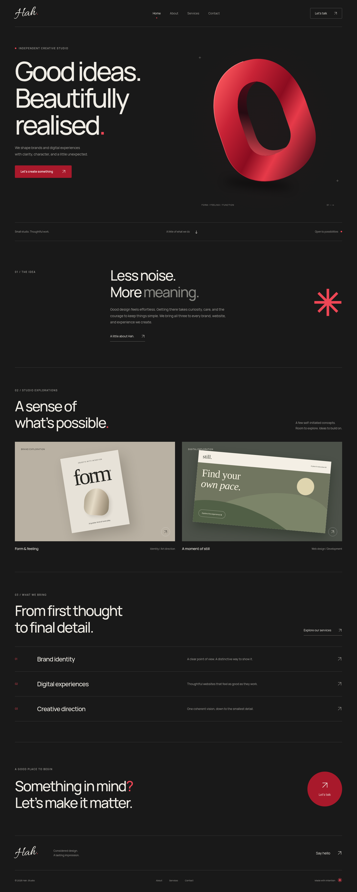

# Hah. Studio

A responsive, four-page creative studio website with a signature wordmark, charcoal palette, and deep crimson accents. Built with **Astro, TypeScript, and CSS**, with self-hosted Manrope and Allura fonts. All artwork is original SVG/CSS; the two homepage explorations are clearly identified as concepts.

## Run locally

Use Node.js **24 LTS** (minimum 22.23.4) and npm.

```sh
npm ci
npm run dev
```

Astro prints the local development address. No database, external font service, or API credentials are needed. Work in this existing checkout; cloud tasks are already isolated, so no additional worktree is required.

```sh
npm run check         # Astro + TypeScript diagnostics
npm run build         # Static production files in dist/
npm run preview       # Serve the production build
npm run format:check  # Source formatting
```

In a restricted cloud shell, use `export ASTRO_TELEMETRY_DISABLED=1` to avoid Astro writing telemetry configuration outside the workspace.

## Pages and features

- `/`: studio introduction, concept work, services, and contact links.
- `/about/`: studio approach and principles.
- `/services/`: service details, working process, and expandable FAQs.
- `/contact/`: validated project brief, email draft, copy/download fallbacks.
- `/404.html`: custom not-found page for static hosts.

The site includes mobile navigation, keyboard focus states, a skip link, reduced-motion support, page descriptions, and optional canonical URLs. No analytics or tracking are included.

## Contact and configuration

The public contact address defaults to **hafiizhamid@gmail.com**, as requested. To change it, copy `.env.example` to `.env` and edit `PUBLIC_CONTACT_EMAIL`, then rebuild. Public variables are visible to visitors; never put credentials in them.

The form **prepares a brief on the page**, then provides an explicit link to open the visitor’s email application with the brief prefilled. It does not send email automatically or store submissions. The visitor must send the draft. If no email app is configured, they can copy or download the brief and send it manually. The email link opens separately so the brief stays available if the browser blocks external handlers. Clipboard access requires a supported secure browser context; download remains available as a fallback. With JavaScript disabled, a direct email link is provided. A hosted submission backend would be a separate integration.

Optional build environment variables:

| Variable               | Purpose                                           | Default                 |
| ---------------------- | ------------------------------------------------- | ----------------------- |
| `PUBLIC_CONTACT_EMAIL` | Public inquiry recipient                          | `hafiizhamid@gmail.com` |
| `SITE_URL`             | Production origin for canonical / Open Graph URLs | Unset                   |
| `BASE_PATH`            | Hosting subdirectory, for example `/Sandbox`      | `/`                     |

## Browser checks

```sh
npx playwright install --with-deps chromium
npm run build
npm test
```

Playwright starts the production preview automatically. Tests run at desktop and phone sizes and cover page rendering, failed assets, horizontal overflow, WCAG A/AA checks through axe, navigation, service selection, native form validation, encoded email drafts, downloaded brief contents, FAQs, and internal links. Automated accessibility checks complement manual keyboard and visual review; they are not a full accessibility certification.

To use an already installed Chromium in this cloud environment:

```sh
ASTRO_TELEMETRY_DISABLED=1 CHROMIUM_PATH=/usr/bin/chromium npm test
```

## Review the design

Screenshots of all four pages are in [`docs/previews/`](docs/previews/). Start `npm run preview` for the interactive production site. Regenerate screenshots with the preview running:

```sh
npm run capture-preview
# Or with the cloud browser:
CHROMIUM_PATH=/usr/bin/chromium npm run capture-preview
```



## Deploy

This is a static website. The build command is `npm ci && npm run build` and the publish directory is **`dist`**. Choose Node 24 in your host’s build settings. Set `SITE_URL` to your real HTTPS origin. Upload the complete `dist/` directory, preserving subdirectories and `_astro/` assets. No SPA rewrite or server runtime is needed. Map unknown routes to `404.html` if your host does not do so automatically.

### GitHub Pages

1. Merge the pull request.
2. In the repository’s **Settings → Pages**, select **GitHub Actions** as the source.
3. In **Actions → Deploy to GitHub Pages**, run the workflow on `main`.
4. Use the deployment URL reported by that workflow.

The manual deployment workflow reads the Pages origin and base path, so project sites such as `/Sandbox/` and configured custom domains get correct links and asset URLs. Deployment is intentionally manual; pushing a branch runs checks without publishing the website.

### Other static hosts

Connect the repository to Netlify, Cloudflare Pages, Vercel (Astro preset), or another static host. Use the build command and output directory above. Leave `BASE_PATH` unset when serving from a domain root. Configure the host’s branch previews if you want a public review URL for each pull request.

## Project structure

```text
src/components/  Shared wordmark, artwork, arrows, and contact CTA
src/layouts/     Document metadata, navigation, footer, self-hosted fonts
src/pages/       Four pages and custom 404
src/styles/      Responsive design and accessibility styles
public/          Favicon
scripts/         Browser screenshot capture
tests/          Desktop and mobile Playwright checks
.github/workflows/  CI and manual GitHub Pages deployment
```

Edit page copy in `src/pages/`, shared colours and spacing in `src/styles/global.css`, and navigation in `src/layouts/Layout.astro`.
